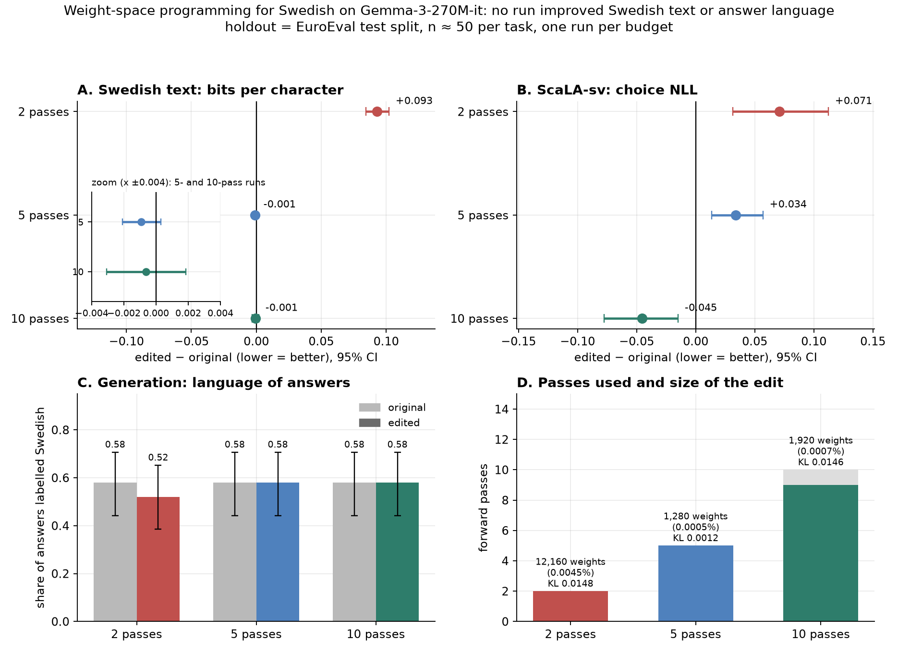

# Research note: can an LLM improve Gemma-3-270M's Swedish by editing its weights directly?

Full commands, configuration, examples and audit details are in `RESULTS.md`; the figure is `figures/results.png`.

## Hypothesis

[Sparks of Weight-Space Programming](https://rikiyat.github.io/blog/weight-space-programming/) reports that a frontier LLM can read and edit a network's weights without training. Its most relevant result is that editing removed an obstacle (reasoning loops in Qwen3.5-0.8B) but added no ability (no gain for Gemma-3-270M on math). We tested whether the same holds for Swedish on the same Gemma model.

**H1.** Gemma-3-270M-it has a small, switchable defect that limits its Swedish, such as a few late-layer neurons that push Swedish text toward Norwegian, Danish or English. An editor that finds and silences them improves Swedish text likelihood or answer language, with no gradients.

**H2.** More forward passes let the editor find such a defect more reliably (budgets 2, 5, 10).

## Experiment

- **Editor.** Claude Opus 5.5 in Kiro CLI, with a harness that counts forward passes, forbids training, and refuses edits to embeddings, the final norm, or whole-tensor scaling. Reading weights is free. The model runs only through `fwd()`.
- **Data.** EuroEval Swedish datasets. The editor sees 30 DEV items per task (train split). We evaluate on a holdout of about 50 items per task (test split) that only `final_eval.py` reads.
- **Tasks.** `lm`: Swedish bits per character. `scala`: grammatical acceptability. `gen`: Swedish questions, with the share answered in Swedish.
- **Runs.** One run each at budgets 2, 5 and 10 (9 passes used). Each submitted one edit that zeroes the output columns of a few MLP neurons (3 to 19 neurons, at most 0.0045% of the weights).
- **Audit.** `verify.py` passed with no failures in all runs. The warnings are listed in `RESULTS.md`.

## Results (holdout, edited minus original, 95% interval)

| Run | Edit | `lm` bits/char (orig 1.896) | `scala` accuracy (orig 0.56) | `gen` Swedish share (orig 0.58) |
|---|---|---|---|---|
| b2 | 19 neurons, layers 12–17 | **+0.093** [+0.084, +0.102] (worse) | 0.00 | −0.06 [−0.14, 0.00] |
| b5 | 2 Norwegian/Danish neurons | −0.001 [−0.002, 0.000] | 0.00 | 0.00 |
| b10 | 3 Scandinavian neurons | −0.001 [−0.003, +0.002] | −0.02 [−0.06, 0.00] | 0.00 [−0.06, +0.06] |

No run met the criterion (lower `lm` bits/char with an interval excluding 0, and a higher Swedish share confirmed by `langdetect`).

## Interpretation

1. **H1 is not supported.** The editors found real language-selective neurons. Zeroing the Norwegian/Danish pair raised Norwegian and Danish bits/char by about 0.03 while leaving Swedish and English alone. That shows the edit does what it says. It did not make Swedish better. The b10 editor also found the model barely confuses languages at Swedish word positions: it gives the Norwegian or Danish form 0.29% of the probability, and the correct word 22%. There is no large switchable defect to remove.
2. **A mechanistic shortcut failed.** The b2 editor ranked neurons by their direct push on the correct token's logit. The sign was wrong even on the texts used to select them, and the edit made Swedish worse. The b10 editor hit the same failure with one neuron (L17 n1977, +5 to 9% bits/char in every language) and then built a better criterion. Direct effects ignore what later layers and the final norm do with a neuron's output.
3. **H2 cannot be tested with this data.** The three runs differ in method as much as in budget. The b2 harm came from a bad criterion, not from having fewer passes. With one run per budget, the budget curve is not estimable.
4. **The only large lever found is not Swedish-specific.** The b10 editor measured that scaling the logits by 0.7 lowers token NLL by 9% (Swedish) and 10% (English). That is general over-confidence on raw text. It would be a global change, so the editor did not make it.
5. **Noise limits the small effects.** With 50 items per task, `lm` effects below about 0.5% (0.005 bits/char) and rate effects below about 10 points are not resolvable (the 10-pass agent's own estimate). The −0.001 differences in b5 and b10 are null results, not gains.

## Recommendation

- **Do not claim a Swedish improvement from this experiment.** The honest finding is a null result at budgets up to 10 on a 270M model, in line with the blog's Gemma math result: the model lacks Swedish ability, and removing a few neurons does not add it.
- **If you continue**, fix the harness first, then scale the evaluation:
  1. Use at least 300 items per task for `lm` and `scala`, and add the other tasks already exported (`swerec`, `hellaswag`, `arc`, `mmlu`, `belebele`).
  2. Isolate the budget effect: three runs per budget with the same editor prompt, and one shared evaluation script.
- **Better-matched test of the hypothesis:** use a model that already has Swedish ability and a measurable failure (for example a larger Gemma that answers in English). The blog's successes were of that kind.
- **Cost.** Each run took 34 to 111 s of GPU time inside passes. The budget is spent mostly on the editor's reasoning, not on compute, so the cost to repeat is the editor's tokens, not the GPU.
