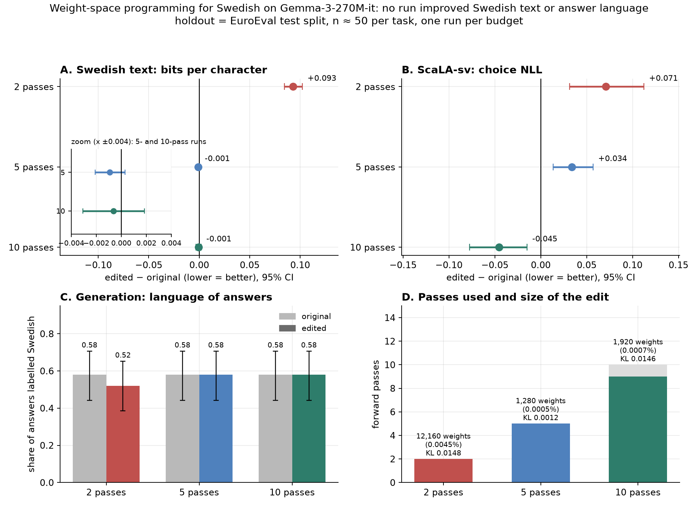

# Results: weight-space programming for Swedish on Gemma-3-270M-it

Three runs of the same harness at 2, 5 and 10 forward-pass budgets. One run per budget, one editor sample each. Numbers come from `sv/runs/<run>/results.json`, `*_eval.md`, `*_verify.md` and the run logs.



*A: paired change in Swedish bits per character (the 5- and 10-pass runs are in the zoom). B: paired change in ScaLA-sv choice NLL. C: share of answers labelled Swedish, original vs edited, with 95% Wilson intervals. D: passes used and size of each edit. Source: `sv/make_figure.py`, which reads `sv/runs/*/results.json` and `forward_log.jsonl`.*

## 1. Commands

Run from `/opt/dlami/nvme/work/attempt1`. The three runs were launched in separate terminals; the loop below runs them one after another. `final_eval.py` is also run by the agent during its run (budget-free); the extra call after `verify.py` reproduces the table for `b<B>_eval.md`.

```bash
export HF_HUB_OFFLINE=1

# data, once (evaluation env holds the euroeval package)
.venv-eval/bin/python sv/make_data.py --name tiny --n-dev 30 --n-holdout 50 --tasks lm scala gen

# runs: budget B in {2, 5, 10}
for B in 2 5 10; do
  uv run --offline python sv/init_run.py --budget $B --run-id b$B-test --data tiny
  sv/run_agent.sh b$B-test                                   # Kiro CLI, claude-opus-5.5
  uv run --offline python sv/verify.py --run sv/runs/b$B-test > b${B}_verify.md
  WSP_RUN_DIR=$PWD/sv/runs/b$B-test uv run --offline python sv/final_eval.py > b${B}_eval.md
done

# figure (matplotlib and pandas are declared in pyproject.toml, installed in .venv)
uv run --offline python sv/make_figure.py                    # -> figures/results.png
```

Launching the three loop bodies in parallel works only if every command sets `WSP_RUN_DIR` for its own run. `sv/runs/CURRENT` is shared, which caused the stray log entry described in the audit (section 6).

## 2. Configuration

| Item | Value |
|---|---|
| Edited model | `google/gemma-3-270m-it`, local copy `gemma-3-270m-it/`. HF cache ref `ac82b4e820549b854eebf28ce6dedaf9fdfa17b3` (the revision the blog authors used). `model.safetensors` sha256 starts `700b710a9a99c295`. 268,098,176 weights, bf16. |
| Editor | Claude Opus 5.5 through Kiro CLI 3.5.0 (`sv/run_agent.sh`; effort `high` is the script default, set by `EFFORT`). Agent prompt: `sv/runs/<run>/PROMPT.md`. |
| Runs | `b2-test` (2 passes), `b5-test` (5), `b10-test` (10). Budget used: 2, 5, 9. |
| Data set | `tiny`: tasks `lm`, `scala`, `gen`. DEV = 30 items per task from the EuroEval **train** split. HOLDOUT = 50 items per task from the EuroEval **test** split (`lm`: 49 after a length filter). Data seed 0 (`sv/make_data.py`). |
| EuroEval | `euroeval` 18.4.0, loaded through the package (datasets are private on the Hub). Dataset revisions: ScaLA-sv `a0a01f24…`, SweReC-mini `ff5e9c50…`, SweDN-mini `339a0ba4…`, MultiWikiQA-sv-mini `42cb590f…`, ScandiQA-sv-mini `5c13f1fd…`. |
| Metrics | `lm`: bits per character on Swedish text (lower is better; pool of ScaLA, SweReC, SweDN, MultiWikiQA). `scala`: ja/nej acceptability, zero-shot, accuracy and `choice_nll`. `gen`: Swedish questions, greedy, 48 new tokens, language label by a function-word heuristic (`sv_rate`), plus `langdetect` as an independent check. |
| Statistics | 95% intervals: Wilson for rates, paired bootstrap over items for differences (B = 2000, seed 0). `langdetect` seed 0. Decoding is greedy, so there is no sampling seed. |
| Software / hardware | torch 2.13.0+cu130, transformers 5.23.0, one NVIDIA L4. bf16 weights, edited tensors cast to bf16 and the saved copy reloaded for the final evaluation. |
| Scoring | Own scorer on exported EuroEval items, not the EuroEval leaderboard code. Numbers compare original and edited model only. |

## 3. Examples (DEV, train split; no holdout items are shown)

`scala` item (gold: `nej`, the sentence is corrupted):
```
Mening: De den tesen så hårt att vi snart blir tvungna att göra samma saker.

Bestäm om meningen är grammatiskt korrekt eller inte. Svara med ja eller nej, och inget annat.
```
`lm` item: raw Swedish text, scored by bits per character, for example `Hur ska du förvara leksaken hemma?`.
`gen` item: a Swedish question sent through the chat template, answered greedily.

Generation, DEV items from the runs' own generation passes (b5 pass 5, b10 pass 8; b2 had no generation pass). Each pair is original vs edited inside one pass:

| Run | Prompt | Original | Edited |
|---|---|---|---|
| b5 | Vem sjunger sången i'm coming home? | *Det er vanskelig å si sikkert vem som sjunger …* (Norwegian) | *Det är en fråga som har fascinerat många människor!* (Swedish) |
| b5 | Vilket datum är Yeo Chin-Huats födelsedag? | Yeo Chin-Huats födelsedag är 1999-07-26. | identical |
| b10 | När började Ringdahl arbeta som ordinarie lärare i en folkskola i Helsingborg? | `ovce` Ringdahl var en ung och hade en stark passion för att lära … | `ovce` Ringdahl var en ung man som var en ung man och han var … |
| b10 | Vilka typer av konstverk skapade Carl Rudolf Carlborg? | `ovce` Carl Rudolf Carlborg var en **en amerikansk konstnärnanhantverkare** … | `ovce` Carl Rudolf Carlborg var en **en amerikansk konstnärnanhistoriker** |

The 5-pass run's single DEV switch from Norwegian to Swedish is the first row. In the 10-pass run most answers differ only in a few words. The `ovce` prefix is explained in section 6.

## 4. The three submitted edits

| Run | Edit (all: set `down_proj` output columns of MLP neurons to 0) | Tensors | Weights changed | % of 268M |
|---|---|---|---|---|
| b2 | 19 neurons in layers 12, 13, 14, 16, 17 that lower the true Swedish token's direct logit (selected by direct logit attribution) | 5 | 12,160 | 0.0045 |
| b5 | L14 n1594 (Danish) and L15 n459 (Norwegian), found from language-selective activations | 2 | 1,280 | 0.0005 |
| b10 | L15 n459, L17 n736, L17 n1067: active on Scandinavian text, silent on English, positive temperature-free first-order gain on DEV | 2 | 1,920 | 0.0007 |

Embeddings and the final norm are unchanged in all three (`verify.py`).

## 5. Holdout results (`final_eval.py`, EuroEval test split, n = 49 to 50)

Delta = edited − original, 95% paired-bootstrap interval in brackets.

| Metric | Original | b2 | b5 | b10 |
|---|---|---|---|---|
| `lm` bits/char (lower is better) | 1.896 | 1.989; **+0.093** [+0.084, +0.102] | 1.895; −0.001 [−0.002, +0.000] | 1.895; −0.001 [−0.003, +0.002] |
| `scala` accuracy | 0.560 | 0.560; 0.000 | 0.560; 0.000 | 0.540; −0.020 [−0.060, 0.000] |
| `scala` choice_nll | 1.072 | +0.071 [+0.031, +0.112] | +0.034 [+0.013, +0.057] | −0.045 [−0.078, −0.015] |
| `gen` sv_rate, harness label | 0.58 | 0.52; −0.06 [−0.14, 0.00] | 0.58; 0.00 [0.00, 0.00] | 0.58; 0.00 [−0.06, +0.06] |
| `gen` sv_rate, `langdetect` | 0.58 | 0.58 | 0.58 | 0.60 |
| `gen` repeat_rate | 0.04 | 0.06 | 0.04 | 0.10 |
| KL(orig ‖ edit), generic prompts (nats) | n/a | 0.0148 | 0.0012 | 0.0146 |

Success criteria from the agent prompt (lower `lm` bpc with interval excluding 0; higher `gen` sv_rate confirmed by `langdetect`): **not met in any run.** The `gen` rows carry the caveat in section 6 (`ovce` prefix). b2 is significantly worse on `lm`. b5 and b10 are indistinguishable from the original on `lm` and `gen`.

## 6. Process and audit

| | b2 | b5 | b10 |
|---|---|---|---|
| Passes used / budget | 2 / 2 | 5 / 5 | 9 / 10 |
| GPU time inside passes | 34 s | 37 s | 111 s |
| Items scored or generated | 894 | 534 | 1,486 |
| Pass kinds | probe, score | generate, probe, score ×2, generate | generate, probe ×6, generate, score |
| Edits tried | 1 | 2 (×2 amplification rejected, then removal) | 5 (E1–E5; E3 submitted) |
| `verify.py` | 0 failures, 1 warning | 0 failures, 2 warnings | 0 failures, 0 warnings |
